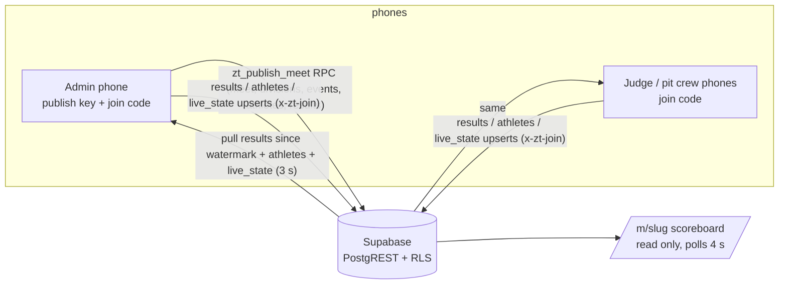

# Phase 1: live sync (Supabase) — notes, 2026-10-16

Goal before 10/24: several phones scoring the same meet, scores converging within seconds, a public
scoreboard URL, and nothing lost when the gym Wi-Fi drops. No accounts yet (that is Phase 2).

## How it works

- **No SDK.** `lib/sync/client.ts` is a 90-line fetch client for PostgREST. Adding `@supabase/supabase-js`
  would need a lockfile regen no machine here can do.
- **Writes are gated by the join code**, sent as the `x-zt-join` header and checked by RLS
  (`zt_has_join`). Reads are public (spectators), except `meets.join_code` and `meets.admin_pin`, which are
  revoked from the API; a phone trades a code for the meet row through the `zt_meet_by_join_code` RPC.
- **Publishing needs a publish key** (`publish_keys` table, unreadable via the API) and goes through the
  `zt_publish_meet` RPC: meet + divisions + events + athletes are authoritative (stale children removed),
  results merge last-writer-wins. The admin phone stores the key in localStorage after you paste it once.
- **Pull watermark is the server clock.** `results.server_at` is set by a trigger on every write; phones
  filter `server_at >= since` (inclusive, merge is idempotent). Client `updated_at` is used only for LWW, so a
  phone with a fast clock cannot hide other phones' scores from everyone else.
- **Last writer wins** on `results` and `live_state`, enforced twice: `mergeResults` on the client and
  the `zt_lww` trigger on the server, so a phone flushing an old offline score can never overwrite a newer one.
- **Offline queue** (`lib/sync/queue.ts`, localStorage `ZEROTACKY_SYNC_QUEUE_V1`): every local change is
  diffed into the queue (coalesced per row) and flushed on the next tick in parent-first order (athletes,
  results, live_state); survives reload. A row the server rejects for good (4xx other than auth) is retried
  alone, then dropped and counted in `status.dropped`, so one bad row never freezes a phone. A rejected write
  never stops the pull that follows it.
- **Re-publish pulls first**, so a walk-on added on a judge phone seconds earlier is in the admin's roster
  before the authoritative roster write.
- **Polling, not websockets** (3 s judge/admin, 4 s scoreboard, paused while the tab is hidden). Realtime
  publication is enabled in the schema for later; polling is simpler and fine for 14 athletes.
- **Same slug = same meet.** `zt_publish_meet` resolves an existing meet by slug and updates it in place (join code
  kept), so a phone that left and re-publishes, or a second admin phone, never creates a duplicate or hits a 409.
- **Composite keys** `(meet_id, id)` on child tables: both presets share ids like `sf-g1`, so a demo and a
  real meet can coexist.
- **Up now** (`live_state`, one row per station) is written only by a phone whose Judge Pad tab is open,
  so an admin phone parked on Setup never fights the station's judge.

## Files
| Layer | File | Tested by |
|---|---|---|
| schema | `supabase/001_schema.sql` (same as `../zt_staging/supabase/001_schema.sql`) | fake server mirrors it |
| mapping | `lib/sync/mapping.ts` | `test/sync.test.mjs` |
| queue | `lib/sync/queue.ts` | `test/sync.test.mjs` |
| HTTP | `lib/sync/client.ts`, `lib/sync/meetApi.ts` | `test/client.test.mjs` (fake fetch) |
| logic | `lib/sync/controller.ts` (link, watermark, flush/pull, LWW, publish/join, dead-letter) | `test/controller.test.mjs` (in-memory server) |
| React | `hooks/useMeetSync.js` (timers, debounce, visibility) | browser smoke |
| UI | `components/shell/SyncDot.jsx` (bottom nav), `components/setup/SyncPanel.jsx` (Setup tab) | browser smoke |
| routes | `app/join/*` (code -> role -> app), `app/m/[slug]/*` (scoreboard) | browser smoke |
| dev | `test/fake_supabase.mjs` (`bun test/fake_supabase.mjs`, `FAKE_DB=file` to persist) | |

Wiring edits outside new files (re-apply after the Argon merge; each is a few lines):
1. `components/strongman-app.jsx`: import `useMeetSync`; `const sync = useMeetSync({...})` after `restoreSnapshot`;
   `sync={sync}` on `<MeetSetup>` and `<BottomNav>`.
2. `components/shell/BottomNav.jsx`: `sync` prop, `<SyncDot sync={sync} />` inside the nav.
3. `components/setup/MeetSetup.jsx`: `sync` prop, `<SyncPanel sync={sync} meet={meet} />` after `<BackupPanel>`.
4. `next.config.mjs`: `allowedDevOrigins: ['127.0.0.1']` (dev only, second "phone" for smoke tests).
Post-Argon: move the dot into the Header's existing green pulse; use `meet.slug` instead of `slugFor(meet.name)`.

## Independent review (verification teammate, 10/16 pm)
14 findings; all HIGH/MEDIUM fixed with regression tests in `test/controller.test.mjs` ("resilience"):
poisoned queue row froze the phone; FK order (result before its athlete); client-clock watermark; republish
could delete a floor walk-on; slug collision on re-publish; join_code/admin_pin readable by anyone; status
`idle` without a link; dropped ticks while busy; republish fired on key paste; missing `search_path`; private
field read from the hook; key-order-sensitive athlete signature. Accepted for v1: athletes have no per-row
clock (local edits are protected by the pending-queue guard and a reducer check that skips a server roster if
anything changed locally mid-pull); any publish-key holder can overwrite any meet (one key, Phase 2 scopes it);
anyone with the join code can read the admin PIN through the RPC (a judge could unlock Setup on their own phone).

## Browser smoke done 10/16 (fake backend on :3078, two origins as two phones)
1. Admin (localhost): paste key, Publish -> join code JC0001, scoreboard link, 14 athletes on the server.
2. Judge (127.0.0.1): `/join?code=JC0001` -> Judge -> app opens linked, locked to judge.
3. Judge scores +3 and locks -> admin phone shows 5 reps locked within a poll; `/m/<slug>?theme=volt`
   shows standings and "Stn 1 up now".
4. Backend killed: judge dot "Offline, will retry", Emily +2 queued. Backend back empty: dot "Sync error"
   (401), queue kept. Admin republishes -> judge flips to "Live", queue flushes, server has Emily 2 by judge device.
5. Leave meet -> edit slug -> publish: slug input slugifies ("Strongfest 2026!" -> `strongfest-2026`); re-publishing an
   existing slug updates in place.
6. Clean backend + stale link: dot reads "ERROR 1" with a Re-join offer; admin republish -> same uuid, fresh
   code; judge re-joins from `/join` (snapshot "before join meet" taken); scores flow via `server_at` watermark.
Bugs found and fixed during smoke, each with a regression test: `onStatus` fired before `ctl` existed
(TDZ crash on any phone that reloaded while linked); an empty roster from the server wiped the local one;
a local reset while linked left the pull watermark past the server's scores.

## Setting up the real backend (Kurt)
1. Supabase dashboard -> new project (free tier). SQL editor -> paste `supabase/001_schema.sql` -> Run.
2. Same editor: `insert into publish_keys (key, label) values ('<long random string>', 'Kurt');`
   (and one for Jess if she will publish from her phone). Keep them out of chat logs.
3. Project settings -> API: copy Project URL and anon public key into Vercel env
   (`NEXT_PUBLIC_SUPABASE_URL`, `NEXT_PUBLIC_SUPABASE_ANON_KEY`), redeploy. Locally: `.env.local`.
4. On your phone: Setup -> Live Sync -> paste publish key -> Save -> Publish. Share the join link or the
   6-char code with judges; share `/m/<slug>` with everyone else.
Without the two env vars the app behaves exactly as before; the sync UI does not render.
5. **Before meet day, wipe the test scores on the server** (a local reset alone gets re-filled from the server
   on the next pull). Replace `<slug>` with the meet's slug (Meet Details -> URL slug):
   `delete from results where meet_id = (select id from meets where slug = '<slug>');`
   `delete from live_state where meet_id = (select id from meets where slug = '<slug>');`
   Then Reset scores on the admin phone and Publish Update; judge phones Leave + re-join (same code).
   Anyone holding the join code can do the same through the API (`DELETE /rest/v1/results?meet_id=eq.<uuid>`
   with `x-zt-join`), which is how the 10/16 test data on `strongfest-2026` was cleared; the join code is
   write access by design (Known limits).
   **Order matters (10/16 lesson):** Leave/Reset on every phone and close every browser tab that has the meet
   joined BEFORE running the delete. A forgotten tab still holds the scores locally and pushes them back on
   its next sync, which looks like the delete never took.
   Take a dump first (`uv run scripts/dump_meet.py <slug> --join-code <code>`, section "Backup" below) so the
   test scores can be inspected or put back if the wipe was a mistake.
6. To retire a meet published by mistake: `delete from meets where slug = '<slug>';` (children cascade).

## Real backend test (10/16, project kagitbfthapxmaljsdtz, dev server :3077)
Schema applied clean; anon reads `meets` public columns only (`join_code` and `publish_keys` -> 401); bad key
-> `401 invalid publish key`. Admin phone (localhost) saved key, slug `strongfest-2026`, Publish -> join
code NS4J82, server has 5 divisions / 3 events / 14 athletes / 3 results, status idle. Judge phone (127.0.0.1)
`/join` -> code -> preview (date, 5 divisions, 14 athletes) -> Judge -> app shows Live; unlocked Jessica,
+2 reps -> server row `reps 7, locked false, updated_by <judge device>`, queue empty. Admin reload -> 7 reps
shown. `/m/strongfest-2026` -> up now Jessica on Stn 1, Ev 1 breakdown 7 reps. Locked scores correctly refuse
+1 REP on the judge pad (first attempt hit Jessica's locked smoke score; not a sync issue).

## Known limits (v1)
- Join code is not public any more, but anyone holding it can also read the meet's admin PIN (RPC).
- Divisions/events edits from the floor need the admin phone (RPC); judge phones can only write
  results, athletes (scratch, rack pins, walk-ons) and live_state.
- Two judge phones on the same station will fight over "up now". One station, one Judge Pad.
- Same athlete + same event edited on two phones: the newer client timestamp wins and the older write is
  dropped silently (Kurt hit this 10/16: locked in the browser, then edited on the phone). A phone whose clock
  runs behind loses such races. Rule for meet day: the judge phone owns scores; the admin phone edits a score
  only when no judge is on that athlete.
- Slug comes from Meet Details (Argon's `meet.slug` field, auto-slugified from the name until edited) and is
  fixed once published; the Sync panel only displays it.
- Config republishes reach judge phones within one poll (fixed 10/16 pm, see below). Phones that were
  linked before the fix catch up on their first pull after the update (configAt starts null).

## Config refresh (10/16 pm)
`pullChanges` now also reads `meets.updated_at` (one cheap select per poll). `zt_publish_meet` sets it to
`now()` on every publish. `SyncLink.configAt` holds the stamp last applied; when the server's is different, a
device-role phone calls `fetchMeetConfig` (meet public columns + divisions + events) and the hook replaces
`divisions`/`events` and merges `meet` (keeps the local `id` and `adminPin`; public columns omit the PIN). The
admin phone is the source of the config, so it only records the stamp. `rowToMeet` now maps `slug`, `isDemo`
and `stations` (Argon's Meet type carries them), so joins and config pulls carry stations + demo flag.
Tests: controller "config republish reaches judge phones" (3), client pullChanges updated. 121 pass.
Real backend: admin changed Ev 2 Group 1 keg 100 -> 110 in Meet Setup -> auto republish -> judge phone
(no reload) had 110 and the new `configAt` within a poll; DEMO pill and `strongfest-2026` slug appeared on
the judge header the same way. Weight set back to 100 afterwards.

## Argon Meet Builder merge (10/16 pm)
Merged Argon's 14 files (`lib/meetBuilder.ts`, `lib/types.ts` additive, `hooks/useMeetState.js`,
`components/setup/builder/*`, `MeetSetup.jsx`, `Header.jsx`, `strongman-app.jsx`, `BUILDER_NOTES.md`,
`test/meetBuilder.test.mjs`) onto the sync tree. Re-wired: `useMeetSync` call in the container, `sync` prop
to Header / MeetSetup, `SyncPanel` after BackupPanel. **SyncDot now lives in the Header brand row**
(`placement="header"`, replaces the static green pulse; renders that pulse when sync is off) and is gone from
BottomNav. Fixed one Argon bug its own test caught: `updateEvent` merged stale `pitCrewCallout.byDivision`
entries back in, so clearing a division callout never stuck (regression test added). `bun test test/` = 118
pass; tsc clean. Smoke on the merged build: header dot + DEMO pill + stations from `meet.stations`; Meet Setup
sections 1-5 render; readiness check passes on the preset; New Blank Meet -> division -> reps event with
weight -> 2 athletes -> readiness Ready -> Judge Pad scores 3 reps, lock, standings correct; loading the
preset back prompts (1 score, snapshot taken); slug set in Meet Details -> Publish relinks to the same server
uuid and join code. `strongman-app.jsx` is 552 lines (Argon's 520 cap not met; not worth a refactor now).
Pre-merge tree backed up at `~/.aki/tmp/zt_pre_argon/`.

## Website skeleton merge (Argon, 10/16 pm)
Argon's public-site skeleton landed as 18 new files (two of the 20 handed over were byte-identical duplicates). Nothing already in the repo changed. Argon's own notes are in `WEBSITE_NOTES.md`; this section records what Slate did with them.

- Files: `lib/website/{types,standingsAdapter,filters,fixtures,data}.ts`, `components/website/{WebsiteShell,ShowsBrowser,ShowDetailClient,GymsBrowser,AccountPreviewClient}.tsx`, `app/website/page.tsx`, `app/website/account/page.tsx`, `app/shows/page.tsx`, `app/shows/[slug]/{page,not-found}.tsx`, `app/gyms/page.tsx`, `app/gyms/[slug]/{page,not-found}.tsx`, `test/website.test.mjs`.
- Routes are additive. `/`, `/join`, `/m/[slug]` and the scorer are untouched; `/website` is the landing page for now (Argon proposes promoting it to `/` after 10/24).
- Fixed: `lib/website/filters.ts` lowercased the `'ALL'` sentinel to `'all'` and then compared it to `'ALL'`, so every show and gym filter returned an empty list. Added `normalizeChoice()`; Argon's own tests caught it (3 failing before the fix).
- Fixed: unknown `/shows/<slug>` and `/gyms/<slug>` returned HTTP 200 with "not found" text. Both pages now call `notFound()` and have a `not-found.tsx` so crawlers and link checkers see a real 404.
- Verified: tsc clean, `bun test test/` 127 pass / 0 fail, dev server 200 on `/website`, `/shows`, `/shows/<fixture slug>`, `/gyms`, `/gyms/the-power-plant-gym-pa`, `/website/account`; 404 on unknown show and gym slugs. Argon did not run tests or a build before handing off.
- Not applied (Argon's proposals, section 4 of `WEBSITE_NOTES.md`, decide after 10/24): tie placement `1, 1, 3` in `calculateDivisionStandings`; `meets` columns `competition_status`, `registration_status`, `results_status`, `is_public_listed` (default false), `venue_json`, `federation`; root route swap (`/scorer` for the meet-day app, `/website` to `/`, with `JoinClient` redirect and `manifest.json start_url` moved together).
- All website data is fixture-only (`lib/website/fixtures.ts`); `data.ts` is the seam where Supabase reads go later.

## Root splash + scorer moved to /scorer (10/16 evening, Kurt's ask)
- `/` is now a thin splash (`components/shell/RootLanding.tsx`): **Enter ZeroTacky** (-> `/website`) and **Join a meet** (-> `/join`, type the code). No QR wording anywhere (Kurt 10/16): the Sync panel QR still encodes `/join?code=XXXXXX` and works with a phone camera, but the UI does not advertise scanning. A phone that already carries a meet (sync link, or a non-demo meet with athletes/results) gets a **Resume: <meet>** button on top, so a judge opening the home-screen icon on meet day lands in the scorer in one tap. Helper `lib/landing.ts` `readResume()`, tests `test/landing.test.mjs` (8).
- The meet-day app lives at **`/scorer`** (`app/scorer/page.tsx`, same loader). localStorage is per origin, so nothing on any phone moved or was lost; the admin phone in the browser panel came up at `/scorer` with Strongfest and Sync: Live.
- Every hard-coded `/` that meant the scorer now says `/scorer`: `public/manifest.json start_url`, the post-join redirect in `JoinClient`, and the three website links (WebsiteShell banner + footer, landing "Run a Meet", account preview). `JoinClient` "Back" goes to `/`.
- Verified: tsc clean, `bun test test/` 135 pass; dev 200 on `/`, `/scorer`, `/join`, `/website`, `/m/strongfest-2026`.

## Meet Setup reorder + Advanced Settings (10/16 evening, sprint items 1-3)
- Station defaults are "Station 1 / Station 2"; `normalizeState` upgrades saved "Stn n" labels, so existing meets rename themselves on load. `supabase/002_station_labels.sql` changes the server default (applied to staging; Kurt runs it on prod).
- Meet Setup order: Meet Details, Divisions, Events, Athletes, Meets/Presets, then a **Results CSV** card that is always visible, then an **Advanced Settings** bar (collapsed by default) holding Role Lock, Backup & Export (minus CSV), Live Sync incl. publish key, Reset/Clear. **Promoter Theme is the last card** and stays visible.
- `components/setup/ResultsCsvCard.jsx` is new; `BackupPanel` takes `hideCsv`.

## Leaderboard + TV/phone layout (10/16 evening, sprint item 4)
- Overall scoring already existed (Standings tab and `/m/<slug>` both call `calculateDivisionStandings`); what was missing was a TV layout. New `components/standings/LeaderboardTable.jsx`: place, athlete, points per event (E1..En, with the raw score under each on TV), total; current event column highlighted.
- Layout mode `phone | tv` (`lib/layout.ts`, `hooks/useLayoutMode.js`, `components/shell/LayoutToggle.jsx`): `?layout=tv` in the URL wins, then the device's last toggle (`ZEROTACKY_LAYOUT_V1`), then auto (landscape and >= 1024 px wide = TV). Toggle button sits in the Standings header, the Pit Crew load card, and the scoreboard header.
- TV mode: `/m/<slug>` goes full width with one leaderboard table per division (two columns on 2xl screens); scorer Standings tab shows the table with the event breakdown beside it; Pit Crew shows the load card and the transition list side by side. Phone layouts unchanged.
- Projector URL for 10/24: `https://zerotacky.com/m/strongfest-2026?layout=tv` (add `&theme=<id>` for a theme). Tests: `test/layout.test.mjs` (5); 141 total.

## Website theme controls (10/16 evening, sprint item 5a)
- `WebsiteShell` is wrapped in `components/website/WebsiteThemeFrame.tsx` (client), which owns `data-zt-theme` through the scorer's `useTheme` hook: same localStorage prefs, so phone and site share the theme. First paint is the default theme to match server HTML; the saved theme applies on mount.
- Header gets `WebsiteThemeControls`: Day/Night toggle (Daylight theme vs last dark theme) and a Configure popover listing all `THEMES` with swatches. Closes on pick, outside click, Escape.
- Theme ideation (new palettes) still open; Slate drafts options for Kurt to react to.

## v2 M2: accounts (10/16 night, branch v2 only)
- **Schema** `supabase/003_auth.sql` (applied to staging `hryiqiopkihkcrkdyllg`; prod gets it when v2 becomes main): `profiles` (id -> auth.users, email, display_name, is_athlete / is_promoter / is_gym_owner; RLS read/update own; `profiles_touch` keeps `updated_at`), `handle_new_user()` trigger creates the row on sign-up (display name from the sign-up metadata, else the email local part) plus a backfill, and `zt_publish_meet` now accepts **a signed-in user (`auth.uid()`) or a legacy publish key**. New meets get `owner_id`; an existing owned meet needs membership; an unowned meet is claimed by the first signed-in publisher; the owner is inserted into `meet_members`.
- **Client** `@supabase/supabase-js` 2.118 added (`lib/auth/supabaseBrowser.ts`, one browser client, storage key `zt-auth-v1`; null without env). `lib/auth/useAuth.ts` = session + profile + actions (password sign-in, sign-up, magic link, sign-out, updateProfile); `lib/auth/profile.ts` = row type + fetch/save + `profileLabel` / `roleBadges`.
- **Sync** `SyncClient.withAccessToken(token)`; `SyncController.setAccessToken(token)` swaps the bearer so publish, pushes and pulls carry the user JWT (RLS policies are role-agnostic, so a signed-in admin phone writes results exactly as before). `publishMeet(..., publishKey | null)` sends `p_key: null` when signed in. `useMeetSync` reads `useAuth()`, feeds the token to the controller (seeded at creation via a ref; follows refresh and sign-out), exposes `canPublish` and `account`; `publish()` and auto re-publish work with a session **or** a key, session wins.
- **UI** `SyncPanel` shows "Publishing as <name>" with an Account link when signed in, otherwise the key box plus "Sign in instead". `/website/account` is real now (`components/website/AccountClient.tsx`; the persona preview `AccountPreviewClient.tsx` is gone, nav says "Account"): tabs Sign in / Create account / Email me a link; signed in: header with badges + Sign out, profile editor (display name, three role cards, Save enabled only when dirty), "Where to next" links. Auth errors arriving in the URL hash (expired link) surface as a notice.
- **Verified on staging via localhost:3079** (v2 working copy, `next dev --webpack`: Turbopack refuses the shared `node_modules` junction): sign-up created `profiles` row "Slate Staging"; email confirmed by SQL (no mailbox), password sign-in; Promoter toggle saved through RLS; Publish from the scorer with **no key** created the meet with `owner_id` set, one `meet_members` row, 14 athletes, Sync: Live; a locked 3-rep score landed in `results` under the user JWT. Tests `test/auth.test.mjs` (5); 146 total, tsc clean.
- **Open:** Supabase Auth URL allow list needs `http://localhost:3079/**`, the v2 Vercel preview URL and `https://www.zerotacky.com/**` before magic links / confirmation emails can land (Kurt owns that list); custom SMTP (Resend) before real users; website header does not yet show the signed-in name; `/promoter` dashboard (Argon) will link from the account page once merged; `listDemoPersonas` in `lib/website/data.ts` is now unused.

## Backup: scripts/dump_meet.py (10/17)
Free-tier Supabase has no point-in-time recovery, so the meet-day backup is a script, stdlib only, run with `uv run`:
- **Dump** (anon read; safe against prod any time): `uv run scripts/dump_meet.py strongfest-2026 --join-code <code>`
  writes `dumps/<slug>_<UTC stamp>.json` (meet row, divisions, events, athletes, results, live_state as PostgREST
  returns them) and `dumps/<slug>_<stamp>_results.csv` (one row per result: event, division, athlete, lot, the
  payload fields as columns, locked, updated_at, updated_by). Prints row counts, never keys. `--join-code` goes
  through `zt_meet_by_join_code` so the meet row includes `admin_pin` and `join_code`; without it the dump has only
  the anon-visible columns and a later restore needs `--admin-pin` or the PIN falls back to the schema default 1050.
  `dumps/` is gitignored because of that. Credentials come from `--env` (default `.env.local`) or
  `SUPABASE_URL` / `SUPABASE_ANON_KEY`.
- **Restore** (writes; needs a publish key): `uv run scripts/dump_meet.py --restore dumps/<file>.json --publish-key <key>`
  calls `zt_publish_meet` with the dumped meet/divisions/events/athletes/results, so it follows the same rules as a
  phone publish: slug resolves the existing meet and updates it in place, stale children are removed, results are
  last-writer-wins by `updated_at` (a newer server row is kept, so restoring an old dump over live scores does not
  clobber them). `--slug other-slug` publishes the dump as a new meet (dropping the dumped id), useful for a
  rehearsal copy. live_state is not restored; judge phones rewrite it. Prints the server counts after publishing.
- **Verified 10/17:** dump of prod `strongfest-2026` (5/3/14/0 results/1 live_state, both anon and join-code
  paths); a copy with one synthetic result restored to staging under `dump-restore-test` (5/3/14/1 on the server,
  admin PIN preserved, result payload/lock/updated_at intact, CSV showed the `reps` and `time_seconds` columns).
- **Meet day 10/24:** take a dump before the wipe in step 5, one after setup is published, and one after each event
  (or a scheduled dump every few minutes from a laptop at the venue); the CSV is the hand-scoring fallback if the
  phones go dark.
